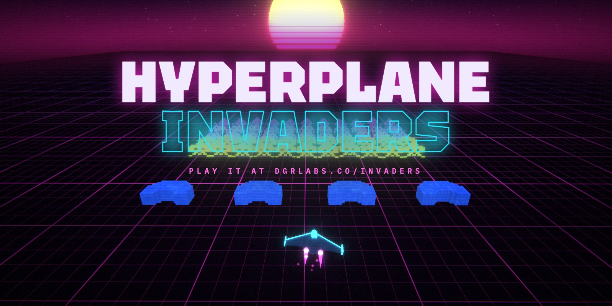

# Hyperplane Invaders

Space Invaders in 3D, played on a neon grid. Play it at [dgrlabs.co/invaders](https://dgrlabs.co/invaders/).

Fifty-five invaders march across the grid toward your ship. Each time the formation reaches an edge it steps closer, and it speeds up as you thin it out. They're built from the original arcade sprites, one cube per pixel, so when you hit one it comes apart into its cubes. Explosions send ripples through the grid floor.

## Controls

| Key | Action |
| --- | --- |
| ← → or A D | Move |
| Space | Fire |
| P or Esc | Pause |
| M | Sound on or off |

On a phone or tablet the game shows touch buttons.

## Scoring

The back row is worth 30 points, the middle rows 20, and the front rows 10. Hit four in a row without missing and your multiplier goes up by one, to a maximum of x8. A miss resets it. The saucer that crosses the back of the field is worth 50 to 300 points, and it drops a power-up (triple shot or rapid fire) that drifts toward you for 10 seconds of use if you catch it. Clearing a wave pays a bonus, and you earn an extra ship every 5,000 points. Your shields come back every third wave.

## How it's made

It's one HTML file with no build step and no image or audio files. Three.js r147 draws the scene and adds bloom, and a final shader pass handles the color fringing, vignette, and scanlines. The grid is a shader that bends the floor wherever something explodes. Every sound is synthesized with the Web Audio API while you play, including the four-note marching bass from the original arcade game.

## Files

- `invaders.html` is the source. It has no document skeleton because the claude.ai artifact host adds one.
- `build.sh` wraps it into `index.html`, a standalone page with a doctype and the dgrlabs.co accessibility tags.
- `index.html` is generated, so don't edit it by hand.

To play it locally, run `python3 -m http.server` in this folder and open http://localhost:8000/. The page loads Three.js from jsDelivr and its fonts from Google Fonts, so it needs a network connection.

## License

MIT. See [LICENSE](LICENSE).
